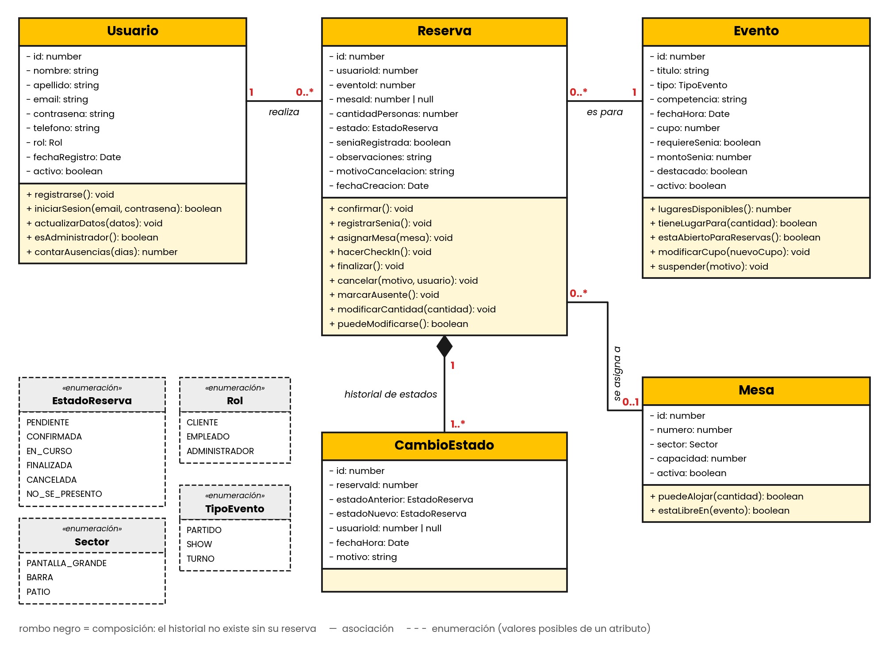
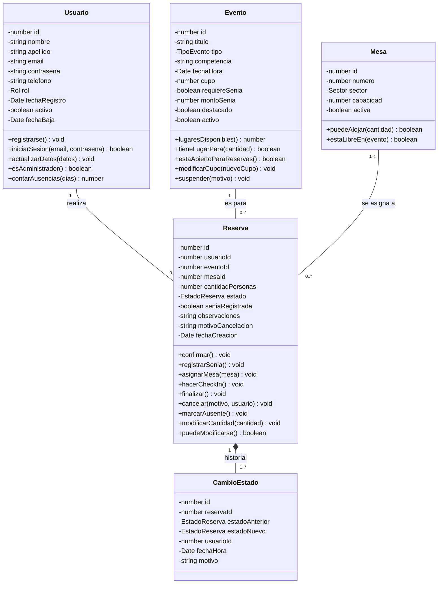

# CHS Burger: sistema de reservas

Sistema de reservas de mesas para partidos y eventos de **CHS Burger**.

Los clientes consultan la agenda de partidos y eventos del local, reservan una mesa y siguen el estado de su reserva. Los empleados registran señas, asignan mesas y hacen el check-in. El administrador carga los eventos y consulta reportes de ocupación.

> Estado actual (Entrega 3): sistema completo, con frontend en React integrado al backend. Incluye el **menú** completo administrable (con fotos, precios y adicionales), registro e inicio de sesión (JWT), agenda de eventos con lugares disponibles, **reservas** con todo su flujo de estados (seña, mesa, check-in, ausencias), procesos automáticos de vencimiento, suspensión de eventos, gestión de **mesas**, **usuarios** y **configuración** del local, perfil de usuario y reportes de ocupación. Los datos se guardan en memoria (arrays).

## Cómo ejecutarlo

Se necesitan dos terminales, una para cada parte.

**Backend**

```
cd Backend
npm install
npm start        # o npm run dev para reiniciar al guardar
```

El servidor escucha en `http://localhost:3000`. Variables de entorno opcionales:

| Variable | Para qué sirve | Valor por defecto |
|---|---|---|
| `PORT` | Puerto del servidor | `3000` |
| `FRONTEND_URL` | Origen permitido por CORS | `http://localhost:5173` |
| `JWT_SECRET` | Clave para firmar los tokens de sesión | una clave de desarrollo (cambiarla en producción) |

Los datos viven en memoria: al reiniciar el servidor vuelven a los datos de ejemplo.

**Frontend**

```
cd Frontend
npm install
npm run dev
```

La aplicación queda en `http://localhost:5173`. Por defecto consume la API en `http://localhost:3000/api`; para cambiarla, copiar `.env.example` a `.env` y modificar `VITE_API_URL`.

## Cuentas de prueba

| Rol | Email | Contraseña |
|---|---|---|
| Administrador | `admin@chsburger.com` | `Admin1234` |
| Empleado | `empleado@chsburger.com` | `Empleado1234` |
| Cliente | `cliente@chsburger.com` | `Cliente1234` |
| Cliente | `sofia@mail.com` | `Cliente1234` |

Los datos de ejemplo están pensados para recorrer todo el sistema:

- *Racing vs. Independiente* empieza **15 minutos después de levantar el servidor**, con dos reservas confirmadas: sirve para probar desde el panel la asignación de mesa y el check-in. A los 20 minutos del inicio, las reservas que no hicieron check-in pasan solas a "No se presentó".
- *Boca vs. River* tiene una reserva pendiente de seña y otra confirmada.
- *San Lorenzo vs. Huracán* se jugó hace una semana: tiene una reserva finalizada y una ausencia, para ver historiales y reportes.

## Frontend

La página de inicio respeta el wireframe de la primera entrega: navbar, portada con llamado a la acción ("Ver el menú"), sobre nosotros, grilla de 4 productos estrella y footer con contacto y redes. Debajo de los productos hay un aviso con el próximo partido. El **menú** y los **eventos** tienen cada uno su propia página. Usa la identidad visual definida: amarillo `#FFC300`, negro `#1A1A1A`, rojo `#D62828` para los botones de acción, Anton para títulos y Poppins para textos.

### Pantallas

| Ruta | Pantalla | Acceso |
|---|---|---|
| `/` | Inicio: portada con el Megabaldazo, sobre nosotros, los 4 productos estrella y el próximo partido | Todos |
| `/menu` | Menú completo por categoría (burgers, línea doble, combos, baldazos, entradas y bebidas), con precios, adicionales y productos agotados | Todos |
| `/eventos` | Agenda de partidos y shows con lugares disponibles, y cómo reservar | Todos |
| `/eventos/:id` | Detalle de un evento y formulario de reserva | Todos (reservar: cliente) |
| `/ingresar`, `/registro` | Inicio de sesión y registro de clientes | Todos |
| `/mis-reservas` | Reservas del cliente (próximas e historial), con modificar y cancelar | Cliente |
| `/mis-reservas/:id/editar` | Modificar cantidad de personas y observaciones | Cliente |
| `/panel/reservas` | Panel de recepción: seña, asignación de mesa, check-in, ausencias, finalizar y cancelar con motivo | Empleado, Admin |
| `/perfil` | Editar los datos propios, cambiar la contraseña y eliminar la cuenta | Con sesión |
| `/admin/eventos` | Listado de eventos: editar, suspender (cancela sus reservas con motivo) y eliminar | Admin |
| `/admin/menu`, `/admin/menu/nuevo`, `/admin/menu/:id/editar` | Productos del menú: alta con imagen, precio y opciones; marcar agotado; elegir destacados; eliminar | Admin |
| `/admin/eventos/nuevo`, `/admin/eventos/:id/editar` | Alta y edición de un evento | Admin |
| `/admin/mesas`, `/admin/mesas/nueva`, `/admin/mesas/:id/editar` | Gestión de mesas: número, sector, capacidad y si está activa | Admin |
| `/admin/usuarios` | Clientes y personal, con filtro por rol; activar y desactivar cuentas | Admin |
| `/admin/usuarios/nuevo` | Alta de empleados y administradores | Admin |
| `/admin/usuarios/:id` | Historial de reservas de un usuario, con sus ausencias | Admin |
| `/admin/reportes` | Ranking de ocupación por evento, cancelaciones y ausencias | Admin |
| `/admin/configuracion` | Capacidad del local y horarios de atención (se muestran en el footer) | Admin |

Si alguien sin sesión entra a una ruta protegida, se lo manda a *Ingresar* y después vuelve a donde quería ir (por ejemplo, al evento que estaba por reservar). Si el rol no corresponde, se muestra *Acceso denegado*.

Las fotos del menú las sirve el backend: las de los productos cargados de ejemplo están en `Backend/public/imagenes/menu/` y las que sube el administrador se guardan en `Backend/uploads/productos/` (fuera de git). La foto del local de "Sobre nosotros" también la sirve el backend (`Backend/public/imagenes/SobreNosotros.png`). La imagen del detalle de evento sigue vacía, con el formato del wireframe.

### Experiencia de usuario y accesibilidad

- Estados de carga en cada pantalla que consulta la API y en los botones mientras se guarda o elimina.
- Un único sistema de notificaciones laterales (toasts) para operaciones exitosas y errores, incluidos los que devuelve el backend y la falta de conexión.
- Validación de formularios en el cliente (además de la del servidor), con mensajes debajo de cada campo y foco en el primer campo con error.
- Confirmación en un diálogo modal antes de eliminar un evento o una mesa, suspender un evento, desactivar una cuenta, cancelar una reserva o marcar una ausencia.
- `label` asociados a cada `input`, botones semánticos, textos alternativos en las imágenes, enlace para saltar al contenido, foco visible, título de pestaña por pantalla y diseño adaptable a celulares.

## Estructura del repositorio

```
├── Frontend/
│   ├── index.html
│   ├── package.json
│   ├── vite.config.js
│   ├── public/               # favicon
│   └── src/
│       ├── main.jsx          # punto de entrada
│       ├── App.jsx           # rutas de la aplicación
│       ├── assets/           # logo (las fotos van acá)
│       ├── components/       # componentes reutilizables (Button, FormField, EventoCard, ConfirmDialog, ...)
│       ├── pages/            # pantallas principales
│       ├── services/         # comunicación con la API: api.js (fetch, token y errores) y un servicio por recurso
│       ├── context/          # sesión del usuario (AuthContext) y notificaciones (ToastContext)
│       ├── hooks/            # useRecurso (carga de datos), useFormulario (validación), useAuth, useToast, useTituloPagina
│       ├── data/             # contenido fijo del negocio (productos, sucursales, contacto)
│       ├── utils/            # formateo, fechas y validaciones
│       └── styles/           # variables de diseño y estilos globales
├── Backend/
│   ├── package.json
│   ├── public/imagenes/menu/ # fotos de los productos del menú
│   ├── uploads/              # imágenes subidas desde el panel (no se versiona)
│   └── src/
│       ├── server.js         # levanta el servidor y el proceso de vencimientos
│       ├── jobs/             # proceso automático que vence señas y marca ausencias cada minuto
│       ├── app.js            # configura Express, rutas y middlewares
│       ├── routes/           # definición de endpoints
│       ├── controllers/      # reciben la petición y devuelven la respuesta
│       ├── services/         # reglas de negocio y validaciones
│       ├── repositories/     # acceso a los datos (arrays en memoria)
│       ├── models/           # clases del dominio
│       ├── middlewares/      # autenticación (JWT), permisos por rol, errores y rutas inexistentes
│       ├── responses/        # formato común de las respuestas
│       ├── exceptions/       # AppError y sus subclases
│       ├── enums/            # Messages, HttpStatus, ReglasNegocio, TipoEvento, Sector, EstadoReserva, Rol
│       └── utils/            # validadores, fechas y parseo de IDs
├── diagrama-clases.png
└── README.md
```

## API

Todas las rutas empiezan con `/api`. Las rutas protegidas necesitan el header `Authorization: Bearer <token>`, que se obtiene al ingresar o registrarse.

### Autenticación

| Método | Ruta | Descripción | Acceso |
|---|---|---|---|
| POST | `/auth/registro` | Crea una cuenta de cliente (`nombre`, `apellido`, `email`, `telefono`, `contrasena`) y devuelve `{ token, usuario }` | Público |
| POST | `/auth/login` | Inicia sesión (`email`, `contrasena`) y devuelve `{ token, usuario }` | Público |
| GET | `/auth/perfil` | Datos del usuario de la sesión | Con sesión |
| DELETE | `/auth/perfil` | Elimina la cuenta propia confirmando la `contrasena` | Con sesión |
| PUT | `/auth/perfil` | Edita nombre, apellido y teléfono; cambia la contraseña con `contrasenaActual` y `contrasenaNueva` | Con sesión |

Las contraseñas se guardan encriptadas con bcrypt y el token dura 8 horas.

### Eventos

| Método | Ruta | Descripción | Acceso |
|---|---|---|---|
| GET | `/eventos` | Lista los eventos con `lugaresDisponibles` y `personasReservadas` | Público |
| GET | `/eventos/:id` | Obtiene un evento por ID | Público |
| POST | `/eventos` | Crea un evento | Admin |
| PUT | `/eventos/:id` | Modifica un evento (solo los campos enviados) | Admin |
| PATCH | `/eventos/:id/suspender` | Oculta el evento y cancela sus reservas activas (`motivo`) | Admin |
| DELETE | `/eventos/:id` | Elimina un evento sin reservas activas | Admin |

Ejemplo de cuerpo para crear:

```json
{
    "titulo": "Racing vs. Independiente",
    "tipo": "PARTIDO",
    "competencia": "Liga Profesional",
    "fechaHora": "2026-12-20T19:00:00Z",
    "cupo": 70,
    "requiereSenia": true,
    "montoSenia": 4000
}
```

### Reservas

| Método | Ruta | Descripción | Acceso |
|---|---|---|---|
| GET | `/reservas/mias` | Reservas del cliente de la sesión | Cliente |
| POST | `/reservas` | Crea una reserva (`eventoId`, `cantidadPersonas`, `observaciones`) | Cliente |
| PUT | `/reservas/:id` | Modifica cantidad de personas u observaciones | Cliente (dueño) |
| GET | `/reservas` | Lista reservas; filtros opcionales `?eventoId=` y `?estado=` | Empleado, Admin |
| GET | `/reservas/:id` | Detalle con evento, mesa, cliente e historial de estados | Dueño, Empleado, Admin |
| PATCH | `/reservas/:id/cancelar` | Cancela (`motivo`, obligatorio para el local) | Cliente (dueño), Empleado, Admin |
| PATCH | `/reservas/:id/senia` | Registra la seña: Pendiente → Confirmada | Empleado, Admin |
| PATCH | `/reservas/:id/mesa` | Asigna una mesa (`mesaId`) | Empleado, Admin |
| PATCH | `/reservas/:id/check-in` | Llegó el cliente: Confirmada → En curso | Empleado, Admin |
| PATCH | `/reservas/:id/finalizar` | En curso → Finalizada | Empleado, Admin |
| PATCH | `/reservas/:id/ausente` | Confirmada → No se presentó | Empleado, Admin |

### Menú

| Método | Ruta | Descripción | Acceso |
|---|---|---|---|
| GET | `/productos` | Productos del menú ordenados por categoría; filtros opcionales `?categoria=` y `?destacado=true` | Público |
| GET | `/productos/:id` | Obtiene un producto | Público |
| POST | `/productos/imagen` | Sube una imagen (`multipart/form-data`, campo `imagen`, PNG/JPG/WEBP de hasta 3 MB) y devuelve su `url` | Admin |
| POST | `/productos` | Crea un producto (`nombre`, `categoria`, `descripcion`, `precio`, `imagen`, `opciones`, `destacado`, `disponible`) | Admin |
| PUT | `/productos/:id` | Modifica un producto (solo los campos enviados) | Admin |
| DELETE | `/productos/:id` | Elimina un producto y su imagen subida | Admin |

Cada opción es `{ "nombre": "Doble", "precio": 3000, "adicional": true }`: si `adicional` es `true` el precio se suma al del producto (*+ $3.000*), si es `false` es el precio final de esa variante (*Con panceta: $59.000*). Reglas: nombre único en el menú, categoría válida, precio entero entre 1 y 1.000.000, hasta 8 opciones y **como máximo 4 productos destacados** (las 4 casillas de la portada).

### Mesas, usuarios, configuración y reportes

| Método | Ruta | Descripción | Acceso |
|---|---|---|---|
| GET | `/mesas` | Mesas con sector, capacidad, si están activas y cuántas reservas activas tienen | Empleado, Admin |
| GET | `/mesas/:id` | Obtiene una mesa | Admin |
| POST | `/mesas` | Crea una mesa (`numero`, `sector`, `capacidad`, `activa`) | Admin |
| PUT | `/mesas/:id` | Modifica una mesa | Admin |
| DELETE | `/mesas/:id` | Elimina una mesa sin reservas activas | Admin |
| GET | `/usuarios` | Usuarios con cantidad de reservas y ausencias; filtro opcional `?rol=` | Admin |
| GET | `/usuarios/:id` | Usuario con su historial de reservas | Admin |
| POST | `/usuarios` | Crea una cuenta de `EMPLEADO` o `ADMINISTRADOR` | Admin |
| PATCH | `/usuarios/:id/estado` | Activa o desactiva una cuenta (`activo`) | Admin |
| GET | `/configuracion` | Capacidad del local y horarios de atención | Público |
| PUT | `/configuracion` | Modifica `capacidadLocal` y `horarios` | Admin |
| GET | `/reportes/ocupacion` | Ocupación, cancelaciones y ausencias por evento, ordenado por personas | Admin |

### Reglas de negocio implementadas

| Regla | Dónde se controla |
|---|---|
| RN1: no se reserva más gente que los lugares disponibles | Crear y modificar reserva |
| RN2: una sola reserva activa por cliente y evento | Crear reserva |
| RN3: de 1 a 10 personas por reserva | Crear y modificar reserva |
| RN4: solo eventos futuros; las reservas cierran 1 hora antes | Crear reserva |
| RN5: el cliente modifica o cancela hasta 2 horas antes | Modificar y cancelar reserva |
| RN6: si el evento pide seña, la reserva queda Pendiente; si no, se confirma sola. Si la seña no se registra en 24 horas (o faltando 2 horas para el evento), se cancela sola | Crear reserva y proceso automático |
| RN7: a los 20 minutos del inicio, la reserva confirmada sin check-in pasa a "No se presentó" (el empleado también puede marcarlo) | Proceso automático y marcar ausente |
| RN8: con 3 ausencias en 90 días, la reserva queda Pendiente de seña aunque el evento no la pida | Crear reserva |
| RN9: la mesa tiene que alcanzar para el grupo y no puede estar en otra reserva del mismo evento | Asignar mesa |
| RN10: email único por cuenta | Registro |
| RN11: no se elimina un evento con reservas activas ni se baja el cupo debajo de lo reservado; si se suspende, se cancelan sus reservas indicando el motivo | Eliminar, modificar y suspender evento |

Otras validaciones del backend:

- **Eventos:** el cupo no puede superar la capacidad del local configurada.
- **Mesas:** número único, sector válido y capacidad de 1 a 20. No se puede eliminar ni desactivar una mesa asignada a reservas activas, ni bajarle la capacidad por debajo de esas reservas.
- **Usuarios:** datos personales obligatorios, email válido y único, y contraseña segura. Una cuenta desactivada no puede iniciar sesión, y el administrador no puede desactivar su propia cuenta.
- **Perfil:** para cambiar la contraseña hay que ingresar la actual. Para eliminar la cuenta se pide la contraseña, no tiene que haber reservas activas y no puede ser la única cuenta de administrador activa. Al eliminarla se borran los datos personales (las reservas pasadas quedan anónimas para el historial y los reportes), la sesión deja de valer y el email queda libre para registrarse de nuevo.
- **Configuración:** la capacidad no puede quedar por debajo del cupo de un evento ya cargado, y tiene que haber de 1 a 7 franjas horarias.

Los estados avanzan solo por las transiciones del diagrama, y cada cambio se guarda en el historial (`CambioEstado`) con fecha, responsable (un usuario o "Sistema") y motivo. El historial también registra las modificaciones que no cambian el estado: cambios de cantidad de personas u observaciones, asignación o cambio de mesa, y mesas liberadas porque el grupo creció. En esos casos el estado anterior y el nuevo son iguales y el motivo describe qué cambió. El cliente y el administrador pueden ver ese historial en cada reserva. El check-in requiere tener una mesa asignada.

El proceso de vencimientos (`src/jobs/procesarVencimientos.js`) corre al iniciar el servidor y después una vez por minuto.

**Limitación conocida:** los datos se guardan en memoria, así que al reiniciar el servidor vuelven a los datos de ejemplo.

Respuesta exitosa: `{ "success": true, "data": { ... } }`. Respuesta con error: `{ "success": false, "message": "El evento no existe." }`.

## Modelo del dominio



| Clase | Qué representa |
|---|---|
| **Usuario** | Persona que usa el sistema. Su `rol` puede ser cliente, empleado o administrador. |
| **Evento** | Partido, show o turno común para el que se puede reservar. Tiene un cupo máximo de personas y puede requerir seña. |
| **Mesa** | Mesa del salón, con su sector (pantalla grande, barra o patio) y su capacidad. |
| **Reserva** | Reserva de un cliente para un evento. Es la entidad principal y recorre el flujo de estados. |
| **CambioEstado** | Historial de los cambios de estado de cada reserva: quién, cuándo y por qué. |

### Relaciones

- Un **Usuario** realiza muchas **Reservas** (1 a 0..*).
- Un **Evento** recibe muchas **Reservas** (1 a 0..*).
- Una **Mesa** se asigna a muchas **Reservas** a lo largo del tiempo; una reserva tiene como máximo una mesa (0..1 a 0..*).
- Una **Reserva** tiene uno o más **CambioEstado** (composición: el historial no existe sin su reserva).

### Flujo de estados de la Reserva

```
Pendiente → Confirmada → En curso → Finalizada
    ↘            ↘ ↘
   Cancelada   Cancelada / No se presentó
```

### Diagrama en Mermaid



> Los métodos del diagrama son una guía de lo que se va a implementar más adelante. Por ahora las clases de `Backend/src/models/` solo definen sus atributos; los valores posibles de `tipo`, `sector`, `estado` y `rol` están en `Backend/src/enums/`.
